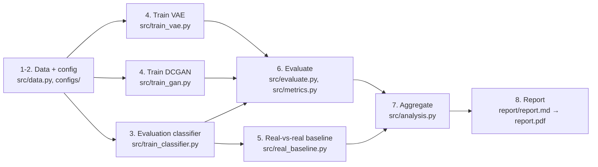

# How the project works, step by step

Read this after the [README](../README.md). It follows the data through the pipeline, from
the raw images to the report. For each step it says what happens, why we built it that way,
which file to open, and which saved output to look at. You do not need a GPU: every output
mentioned here is already committed in `runs/` and `results/`.

## The pipeline at a glance



| Step | Command | Writes to |
|---|---|---|
| 1–2. Data + config | used by every script | `data/` (download), `runs/<run>/config.yaml` |
| 3. Evaluation classifier | `python -m src.train_classifier --config configs/classifier.yaml` | `runs/classifier_fashion_mnist/` |
| 4. Train a model | `python -m src.train_vae --config configs/vae.yaml` (or `train_gan`, `gan.yaml`) | `runs/<run>/` |
| 5. Real-vs-real baseline | `python -m src.real_baseline` | `runs/real_baseline_fashion_mnist/` |
| 6. Evaluate a model | `python -m src.evaluate --config configs/vae.yaml` | `runs/<run>/eval/` |
| 7. Aggregate all runs | `python -m src.analysis` | `results/` |
| 8. Build the report | `bash report/build.sh` | `report/report.pdf` |

`scripts/run_main.sh` and `scripts/run_ablation.sh` chain steps 3–7 for every seed and setting
([RUNNING_EXPERIMENTS.md](RUNNING_EXPERIMENTS.md) explains how to run them).

---

## Step 1. Data

**What.** Fashion-MNIST: 60,000 training and 10,000 test grayscale images (28×28) of clothing
in 10 balanced classes (T-shirt, trouser, pullover, dress, coat, sandal, shirt, sneaker, bag,
ankle boot). Every image is zero-padded to 32×32 and scaled from [0, 1] to [−1, 1].

**Why.**
- *32×32* because the shared network doubles the image size at every layer
  (4 → 8 → 16 → 32).
- *Padding, not resizing.* Interpolation would blur the **real** images, which are the
  reference for our sharpness metrics, and that would favour the blurrier model.
- *[−1, 1]* matches the `tanh` output of the decoder/generator.
- The models train on the training split only. The test split is the reference for every
  metric.

**Code.** [src/data.py](../src/data.py): `get_loader` for training, `load_split` (whole split
as tensors) for evaluation. `tests/test_data.py` checks the padding and the value range.

## Step 2. Configuration: one file for everything shared

**What.** [configs/shared.yaml](../configs/shared.yaml) holds every setting both models must
share: dataset, latent size (32), network width, batch size (128), epochs (30), seed. Each
model config starts with `base: shared.yaml` and adds **only** its optimiser settings:

| File | Adds |
|---|---|
| [configs/vae.yaml](../configs/vae.yaml) | Adam lr 1e-3, `beta: 1.0` (KL weight) |
| [configs/gan.yaml](../configs/gan.yaml) | Adam lr 2e-4, β1 = 0.5 (the DCGAN paper's settings) |
| [configs/classifier.yaml](../configs/classifier.yaml) | 8 epochs, Adam lr 1e-3 |

Any setting can be changed from the command line with the same syntax in every script:
`--set seed=1 latent_dim=8`. A typo in the key raises an error instead of being ignored.

**Why.** Fairness by construction. Changing `epochs` changes it for both models at once, and
`tests/test_config.py` fails if a model config ever overrides a shared setting.

**Run names.** The config decides the output folder, for example
`runs/vae_fashion_mnist_z32_beta1_seed0/` or `runs/gan_fashion_mnist_z32_seed0/`
(`run_name` in [src/utils.py](../src/utils.py)). Each run saves its exact settings in
`config.yaml`. Re-running the same config **replaces** that folder.

**Code.** [src/config.py](../src/config.py) (45 lines).

## Step 3. The evaluation classifier: a measuring instrument

**What.** A small 5-layer CNN ([src/models/classifier.py](../src/models/classifier.py)) trained
for 8 epochs on the real training images. Test accuracy: **90.7%**. It is *not* one of the
two compared methods. We use it only to measure the generators, in two ways:

1. **As a labeller.** It labels each generated image. The class histogram shows whether a
   model skips some classes (mode collapse).
2. **As a feature space.** Its 128-d penultimate layer (`embed`) is used to compute FID and
   precision/recall, in addition to the standard Inception network. Inception was trained
   on ImageNet photos, not on 32×32 grayscale clothing.

**Why it matters.** Every evaluation must use the **same** classifier, otherwise the numbers
are not comparable. That is why `runs/classifier_fashion_mnist/classifier.pt` is committed
and `run_main.sh` only trains a new one if it is missing.

**Code.** [src/train_classifier.py](../src/train_classifier.py).

## Step 4. The two models and how they are trained

### One architecture for both models

| Network | Class in [src/models/networks.py](../src/models/networks.py) | Used as |
|---|---|---|
| Image producer: z → 1×1 → 4×4 → 8×8 → 16×16 → 32×32 (transposed convs, 256/128/64 channels, BN + ReLU, tanh), 788,353 parameters | `ConvDecoder` | VAE decoder **and** GAN generator |
| Image reader: 32×32 → 16 → 8 → 4 (strided convs, LeakyReLU) + output head | `ConvEncoder` | VAE encoder (head: 2 × 32 numbers = μ, log σ²) **and** GAN discriminator (head: 1 logit) |

Both models also get the same DCGAN weight initialisation (`init_dcgan_weights`). Because the
image-producing network is literally the same class with the same size, any difference in the
results comes from the **training objective**, which is the thing we study.
`tests/test_models.py` checks that the two decoders are identical.

The wrappers are short: [src/models/vae.py](../src/models/vae.py) (encode → reparameterize →
decode) and [src/models/gan.py](../src/models/gan.py) (generator + discriminator).

### The training loops

Both scripts loop over 30 epochs of 468 mini-batches. Only the inner step differs:

```text
VAE  (src/train_vae.py)                       DCGAN  (src/train_gan.py)
---------------------------------------       -------------------------------------------------
x̂, μ, log σ² = vae(x)                         z ~ N(0, I);  fake = G(z)
loss = ‖x − x̂‖² summed over pixels            D step: push D(x) → 1 and D(fake) → 0
       + β · KL(q(z|x) ‖ N(0, I))             G step: minimise −log D(G(z))  (non-saturating)
one Adam step                                  one Adam step for each network
```

The losses are in [src/losses.py](../src/losses.py) (53 lines). The most important design
choice is that the VAE's squared error is **summed** over the 1,024 pixels, not averaged. An
average would weight the KL term about 1000× more, a hidden β ≈ 1000 that would make the
samples much blurrier (README, "Key design choice"). `tests/test_losses.py` checks both losses.

### What every training run saves

| File in `runs/<run>/` | Content | Try this |
|---|---|---|
| `config.yaml` | the exact settings | compare a VAE and a GAN config: only the optimiser lines differ |
| `train_log.csv` | one row per epoch: VAE `loss, recon, kl`; GAN `loss_d, loss_g, d_real, d_fake` | in a GAN log, `d_fake` stays between about 0.17 and 0.32: D never "wins" |
| `samples/epoch_001.png` … `epoch_030.png` | the **same** 64 latent vectors decoded after every epoch | flip through them to watch a model learn |
| `checkpoints/epoch_030.pt` | the final model (epochs 5–25 are kept locally only) | used by step 6 |

A VAE run takes about 4 minutes and a DCGAN run about 6.5 minutes on an Apple M3 Max GPU.

## Step 5. Real-vs-real baseline: what is a "good" score?

**What.** [src/real_baseline.py](../src/real_baseline.py) runs the **same metric code** with
10,000 random *training* images in place of generated ones, compared with the test images.

**Why.** These metrics have no absolute scale: is an FID of 5 good? A perfect generator would
score about what real data scores against real data. Result: FID-classifier 0.03,
precision/recall 0.90 / 0.89 (Inception space: FID 2.4, P/R 0.78 / 0.78). It is the
"Real data" row of every main table.

## Step 6. Evaluation: turning a checkpoint into numbers and figures

**What.** [src/evaluate.py](../src/evaluate.py) loads a checkpoint, generates 10,000 images
from fixed latent vectors (`--eval-seed 0`, so every model sees the same draws) and compares
them with the 10,000 test images. It computes, in this order:

| # | Measures | Metric (function in [src/metrics.py](../src/metrics.py)) | Hypothesis |
|---|---|---|---|
| 1 | quality + diversity | FID (`frechet_distance`), precision / recall (`precision_recall`, k = 3), in classifier **and** Inception feature space | H1, H2 |
| 2 | mode collapse | class histogram, modes covered, class KL (`mode_coverage`), mean classifier confidence | H2 |
| 3 | sharpness | Laplacian variance (edges), HF ratio (Fourier energy above 0.25 cycles/px); real-image values stored alongside | H1 |
| 4 | latent smoothness | 100 slerp paths of 10 frames; coefficient of variation of step sizes (`slerp`, `path_smoothness`) | H3 |
| 5 | reconstruction | PSNR on test images (`psnr`), **VAE only**: the GAN has no encoder | – |
| 6 | memorisation | nearest-training-image distance of samples vs. of test images (`nearest_neighbors`) | – |
| 7 | qualitative figures | see below | – |

Each metric is a short, self-contained function, and `tests/test_metrics.py` checks each one
on inputs with a known answer. For example, identical sets give FID = 0, a generator that
covers only half the data gets recall ≈ 0.5, and blurring lowers both sharpness measures.
Definitions and the "better" direction of each metric are in
[PROJECT_PLAN.md](PROJECT_PLAN.md) §4.

**Outputs** in `runs/<run>/eval/epoch_030/`:

| File | Shows |
|---|---|
| `metrics.json` | every number above |
| `samples.png` | 64 random samples (not cherry-picked) |
| `most_confident.png` / `least_confident.png` | successes / failure cases according to the classifier |
| `interpolation.png` | one slerp path per row: smooth morphing or sudden jumps? |
| `nearest_neighbors.png` | each sample above its closest training image: is the model copying? |
| `reconstructions.png` | VAE only: test image above its reconstruction |

**Quick mode.** `--all-epochs --quick` evaluates every saved checkpoint with 5,000 samples,
classifier space only and no figures, into `eval/epoch_XXX_quick/`. These folders are the
learning curves. Quick and full evaluations never overwrite each other.

## Step 7. Aggregation: from 12 runs to report tables

**What.** [src/analysis.py](../src/analysis.py) reads every `runs/*/eval/*/metrics.json`,
keeps the last full evaluation of each run, groups runs that differ only in their seed, and
writes mean ± std tables and figures to `results/`:

| File in `results/` | Content |
|---|---|
| `main_results.md` | VAE vs. DCGAN (z = 32, β = 1, 3 seeds) + the real-data row |
| `ablation_latent_dim.md`, `ablation_beta.md` (+ `.png`) | the two ablations |
| `all_runs.csv` | every number of every run, one row per run |
| `precision_recall.png`, `mode_coverage.png`, `sharpness.png` | H1 / H2 figures |
| `learning_curve.png`, `training_curves.png` | training dynamics |
| `qualitative_*.png` | the step-6 figures of both models side by side |

Re-running `python -m src.analysis` rebuilds all of `results/` from `runs/` in a few seconds.
It only looks one level deep (`runs/<run>/eval/`), so side experiments in subfolders such as
`runs/epoch_check/` never mix into the tables.

## Step 8. The report

[report/report.md](../report/report.md) is the write-up (6 pages + references). Every number in
it comes from `results/`. `bash report/build.sh` turns it into `report/report.pdf` (committed,
so you can read it without installing anything) and `report.docx`.

---

## The experiments we ran

| Experiment | Question | Runs (folders in `runs/`) | Result in one line |
|---|---|---|---|
| **E1** main comparison | VAE vs. DCGAN at identical settings | `vae_fashion_mnist_z32_beta1_seed{0,1,2}`, `gan_fashion_mnist_z32_seed{0,1,2}` | DCGAN wins fidelity **and** diversity; VAE has the smoother latent space |
| **E2** learning curves | Did training converge? Is it stable? | `eval/epoch_XXX_quick/` of the E1 runs | DCGAN converges by epoch ~15; VAE still improves slowly at 30; D never overpowers G |
| **E3** latent size | Does z = 8 / 128 change the picture? | `*_z8_*seed0`, `*_z128_*seed0` | ranking never changes |
| **E4** KL weight β | What does β trade off in the VAE? | `vae_fashion_mnist_z32_beta0.5_seed0`, `..._beta4_seed0` | larger β: blurrier, higher precision, much lower recall |
| Epoch check | Is 30 epochs unfair to the VAE? | `epoch_check/vae_fashion_mnist_z32_beta1_seed0` (60 epochs) | FID-clf only 21.1 → 18.4, so we kept 30 (decision 2) |

The headline numbers are in the [README](../README.md#results-at-a-glance). The explanation
of *why* each hypothesis held or failed is in report §5.

## Glossary

| Term | Meaning here |
|---|---|
| **Latent vector z** | the 32 random numbers a generator turns into an image |
| **ELBO** | the VAE's training objective: reconstruction quality minus the KL term |
| **KL term / β** | pulls each image's latent code towards N(0, I); β is its weight (β-VAE) |
| **Reparameterization trick** | z = μ + σ·ε, so gradients can flow through random sampling |
| **Discriminator D / generator G** | the GAN's two networks: D tells real from fake, G tries to fool D |
| **Mode collapse** | a GAN producing only a few kinds of images (e.g. only shoes) |
| **Fidelity / diversity** | does each sample look real? / do the samples cover the whole dataset? |
| **FID** | distance between the feature statistics of real and generated images (lower is better) |
| **Precision / recall** | share of samples that look like real data / share of real data the samples cover |
| **Laplacian variance, HF ratio** | edge strength and high-frequency energy: classical sharpness measures |
| **slerp** | spherical interpolation between two latent vectors |
| **Seed** | the random-number setting of a run; 3 seeds show how much results vary by chance |
| **Checkpoint** | the saved weights of a model at some epoch |

## Where to go next

- **Run or extend** the experiments: [RUNNING_EXPERIMENTS.md](RUNNING_EXPERIMENTS.md)
- **Protocol, metric definitions, rubric mapping, open decisions, task split:**
  [PROJECT_PLAN.md](PROJECT_PLAN.md)
- **Full analysis and discussion:** [report/report.pdf](../report/report.pdf)
