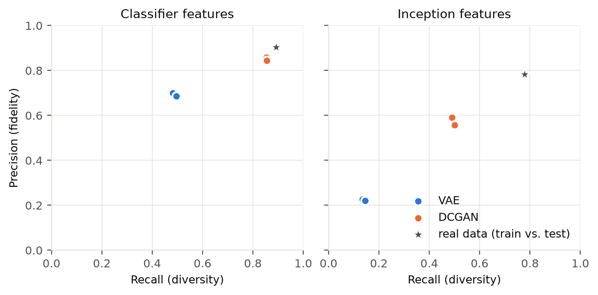
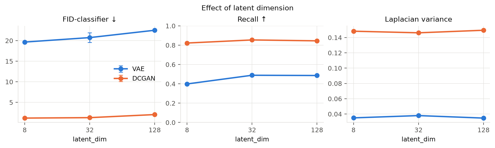

<!-- Build PDF + DOCX:  bash report/build.sh   (needs pandoc and Google Chrome)
     Every number below comes from results/ (generated by src/analysis.py). If the runs
     are redone, regenerate results/ and update the numbers here. -->

## 1. Problem and motivation

A generative image model learns an unknown distribution $p_\text{data}(x)$ from examples and
then produces new images from it. Two classic families do this in very different ways. A
**Variational Autoencoder (VAE)** maximises a lower bound on the likelihood of the data
[1]. A **Generative Adversarial Network (GAN)** trains a generator to fool a learned
discriminator [2]. A common observation is that VAE samples are *blurry but varied*, while
GAN samples are *sharp but may miss parts of the data* ("mode collapse"). This trade-off
between **fidelity** (each sample looks real) and **diversity** (the samples cover the whole
data distribution) matters in practice: synthetic training data is useless if it is
unrealistic and harmful if it covers only some classes. Measuring the trade-off is itself a
vision problem. A generated image has no ground-truth target, so the evaluation must compare
*distributions* of images.

Published comparisons usually give each objective its own separately tuned network, which
makes it hard to tell whether a difference comes from the objective or from the
architecture. We therefore ask: **with the same image-producing network, latent size, data
and training budget, how do a VAE and a DCGAN trade off fidelity/sharpness against
diversity/mode coverage?** We test three hypotheses on Fashion-MNIST (3 seeds, plus two
ablations):

* **H1:** the GAN produces sharper samples with a lower FID.
* **H2:** the VAE covers the data better (higher recall, no mode collapse) and trains more
  stably.
* **H3:** the VAE has a smoother latent space.

## 2. Method

### 2.1 Variational Autoencoder

An encoder maps an image $x$ to the mean $\mu(x)$ and log-variance $\log\sigma^2(x)$ of a
Gaussian posterior $q(z\mid x)$ over a $d$-dimensional latent code. A decoder maps $z$ back to
an image $\hat x$, and the prior is $p(z)=\mathcal N(0,I)$. Training maximises the evidence
lower bound (ELBO) [1]:

$$\log p(x) \;\ge\; \mathbb E_{q(z\mid x)}\big[\log p(x\mid z)\big] \;-\; \mathrm{KL}\big(q(z\mid x)\,\|\,p(z)\big).$$

We use a Gaussian decoder with fixed variance, so $-\log p(x\mid z)$ is the squared error
$\|x-\hat x\|^2$ **summed over pixels** (up to a constant). The KL between two Gaussians has a
closed form, $\tfrac12\sum_j(\mu_j^2+\sigma_j^2-\log\sigma_j^2-1)$. Our loss per image is
therefore

$$\mathcal L_\text{VAE} = \|x-\hat x\|^2 + \beta\,\mathrm{KL}\big(q(z\mid x)\,\|\,\mathcal N(0,I)\big),$$

with $\beta=1$ for the standard VAE and $\beta\neq1$ for a β-VAE [4]. Sampling inside the
network is made differentiable with the *reparameterization trick*,
$z=\mu+\sigma\odot\varepsilon$ with $\varepsilon\sim\mathcal N(0,I)$, so gradients flow
through $\mu$ and $\sigma$.

**Design choice: sum, not mean, over pixels.** A 32×32 image contributes 1024 squared-error
terms, while the KL has only $d=32$ terms. Averaging the reconstruction error over pixels
(a common shortcut) would make the KL about 1000× stronger. That is a hidden β ≈ 1000, which
changes the very blurriness we want to measure. With the sum, the loss is the true negative
ELBO and β is the only weight on the KL.

**Why VAEs blur.** For a given $z$, the decoder output that minimises expected squared error
is the *mean* of all images whose posteriors overlap at $z$. The KL term pulls every
posterior towards the same prior, so these posteriors do overlap. The decoder then outputs an
average of several plausible images, for example shirts with different textures, and
averaging acts as a low-pass filter.

### 2.2 Deep Convolutional GAN

A generator $G$ maps $z\sim\mathcal N(0,I)$ to an image, and a discriminator $D$ outputs the
probability that its input is real. $D$ minimises binary cross-entropy (real → 1,
fake → 0). $G$ minimises the *non-saturating* loss $-\log D(G(z))$. This has the same fixed
point as the original minimax game but gives stronger gradients early in training, when $D$
easily rejects the fakes [2]. We follow the DCGAN recipe [3]: strided (transposed)
convolutions, batch normalisation, ReLU/LeakyReLU, $\mathcal N(0,0.02)$ initialisation, and
Adam with learning rate $2\cdot10^{-4}$ and $\beta_1=0.5$. We alternate one $D$ step and one
$G$ step.

**Why GANs are sharp but can drop modes.** $D$ is itself a CNN and detects blur easily, so $G$
is pushed towards crisp, realistic images. However, $G$ is only penalised for samples that
*look fake*, never for data it *fails to produce*. Nothing in the objective asks $G$ to cover
every mode, so mapping many latent codes to a few convincing images is a stable shortcut
(the "Helvetica scenario" in [2]).

### 2.3 One architecture for both models (fairness by construction)

The VAE decoder and the GAN generator are the **same class**, `ConvDecoder`. Its transposed
convolutions grow the image from 1×1 to 4, 8, 16 and 32 pixels with 256/128/64 channels,
BN + ReLU and a tanh output (788k parameters). The VAE encoder and the discriminator are also
one class, `ConvEncoder`. Its strided convolutions shrink the image from 32 to 4 pixels with
LeakyReLU, and only its output head differs: $2d$ numbers ($\mu$, $\log\sigma^2$) for the VAE
and one logit for $D$. Unit tests check that the image networks are identical and that
neither model config overrides a shared setting (Table 1).

| Shared by both models | Different (and why) |
|---|---|
| Data, padding, scaling to [−1, 1] | **Training objective**: the variable under study |
| Image-producing network (`ConvDecoder`, 788k params) | Encoder head: 2d outputs (VAE) vs. 1 (D) |
| Latent size $d=32$, batch size 128, 30 epochs, seeds 0/1/2 | Optimiser settings: each paper's standard (VAE: Adam $10^{-3}$; DCGAN: Adam $2\cdot10^{-4}$, $\beta_1=0.5$) |
| DCGAN weight initialisation | |
| Evaluation code, the 10,000 latent vectors, all metrics | |

: **Table 1.** Fair-comparison protocol. Shared settings live in one config file
(`configs/shared.yaml`) that both model configs inherit.

### 2.4 Evaluation

We compare the *distribution* of 10,000 generated images with the 10,000 Fashion-MNIST test
images (Table 2) in two feature spaces. The first is the standard **Inception-v3** pool
features for FID [5] (2048-d). The second is the 128-d penultimate layer of our own
**evaluation CNN** (90.7% test accuracy), which is trained only to *measure* the generators.
We add it because Inception was trained on ImageNet photographs, not on 32×32 grayscale
clothing.

| Metric | What it measures | Better |
|-----------------|----------------------------------------------------------------------|------|
| FID [5] | Fréchet distance between Gaussians fitted to real and generated features: fidelity + diversity | ↓ |
| Precision / recall [6] | share of generated samples inside the real manifold (fidelity) / of real samples inside the generated manifold (diversity); $k=3$ nearest-neighbour balls | ↑ |
| Modes, class KL | evaluation-CNN labels of the samples: classes with ≥1% of them; KL($p_\text{gen}\,\|\,p_\text{real}$) | ↑ / ↓ |
| Laplacian var. [7] | edge strength (2nd-derivative filter) | ≈ real |
| HF ratio | share of 2-D FFT energy above 0.25 cycles/pixel | ≈ real |
| Interp. CV | std/mean of feature-space steps along 100 slerp paths [8] of 10 frames; proxy for perceptual path length [9] | ↓ |
| NN ratio | median pixel distance generated → nearest training image, divided by the same for test images | ≈ 1 |
| Recon. PSNR | VAE only: encoder–decoder reproduction of test images | ↑ |

: **Table 2.** Metrics. The two sharpness metrics are classical CV operations (edge detection
and the Fourier transform). Values *above* the real level mean noise, not extra sharpness.

Two checks make these numbers interpretable. First, **unit tests on inputs with a known
answer**: identical sets give FD = 0; a "generator" that produces only one of two clusters
gets precision > 0.95 but recall ≈ 0.5; blurring lowers both sharpness measures. Second, a
**real-vs-real baseline** runs the same metric code with 10,000 real *training* images in
place of the generated ones. This gives the best score a perfect generator could expect with
our sample size and feature spaces.

## 3. Implementation and data

**Data.** Fashion-MNIST [10] has 60,000 training and 10,000 test grayscale 28×28 images in
10 balanced clothing classes. We **zero-pad** the images to 32×32 instead of resizing them,
because interpolation would blur the *real* images, which are the reference for our
sharpness metrics. Pixels are scaled to [−1, 1] to match the tanh output. The models train on
the training split only, and the test split is the reference for every metric.

**Code.** We wrote the project in PyTorch (commands in `README.md`). Every run saves its
config, a per-epoch loss log, sample grids and a checkpoint every 5 epochs. One script
evaluates both models with the same 10,000 latent vectors, so the grids in this report show
the same random draws for both models and are not cherry-picked. Every table and figure is
generated by `src/analysis.py` from the saved metrics. For Inception we use the standard FID
port in torchmetrics/torch-fidelity [11]. There are 49 automated tests, including one that
runs the whole pipeline end to end on a toy dataset.

**Training.** Each model trains for 30 epochs: 468 mini-batches of 128 images per epoch,
14,040 updates in total. We use seeds 0, 1 and 2 on a laptop GPU (Apple silicon, PyTorch MPS).
A VAE run takes about 5 minutes and a DCGAN run about 8, because the GAN needs two
forward/backward passes per step.

<!-- ======================================================================================
     §4–§6 are a TEMPLATE until the experiments are run (docs/RUNNING_EXPERIMENTS.md).
     Replace every **[FILL IN: ...]** with numbers from results/ and write the verdicts
     from what the data actually shows. A hypothesis that turns out false is fine, as long
     as you explain why. Delete these comments before submitting.
     Page budget (guidelines: 4–6 pages excluding references): §1–3 take ≈ 2.7 pages, so
     §4–6 must fit in ≈ 3 pages INCLUDING the 5 figures. Check with: bash report/build.sh
     ====================================================================================== -->

## 4. Experiments and results

We run four experiments:

* **E1, main comparison.** VAE vs. DCGAN at the default settings, 3 seeds each.
* **E2, learning curves.** Every saved checkpoint (every 5 epochs) of the E1 runs, evaluated
  with 5,000 samples.
* **E3, latent size.** $d\in\{8,32,128\}$ for both models.
* **E4, KL weight.** $\beta\in\{0.5,1,4\}$ for the VAE.

E3 and E4 use **[FILL IN: 1 or 3]** seed(s).

### 4.1 Main comparison (E1)

<!-- Paste results/main_results.md here, keeping only the most informative columns
     (suggestion: FID-Inc, FID-clf, Precision-clf, Recall-clf, Modes, Class KL, Laplacian var,
     HF ratio, Interp. CV). Keep the real-data row: it is what makes the numbers readable. -->

| Model | FID-Inc ↓ | FID-clf ↓ | Prec. ↑ | Recall ↑ | Modes ↑ | Class KL ↓ | Lapl. var | HF ratio | Interp. CV ↓ |
|---|---|---|---|---|---|---|---|---|---|
| VAE | [FILL IN] | | | | | | | | |
| DCGAN | [FILL IN] | | | | | | | | |
| Real data (train vs. test) | [FILL IN] | | | | 10 | | | | – |

: **Table 3.** Main results: mean ± std over 3 seeds. Precision and recall are computed in
the classifier feature space. The last row runs the same metrics on real training images.

{width=70%}

{width=60%}

**[FILL IN: 3–5 sentences describing what Table 3 and the two figures show. Report the
numbers only; save the interpretation for §5.]**

### 4.2 Training dynamics (E2)

{width=60%}

**[FILL IN: Did FID stop improving before epoch 30, so the budget was sufficient? Which model
varies more between seeds (width of the band)? Did $D(G(z))$ ever collapse to 0?]**

### 4.3 Ablations (E3, E4)

{width=80%}

<!-- Optional if there is room: ../results/ablation_beta.png (effect of β on the VAE). -->

**[FILL IN: one sentence per ablation with numbers from `results/ablation_latent_dim.md` and
`results/ablation_beta.md`. Expected direction to check: larger β → blurrier samples (lower
Laplacian variance) but a smoother latent space. Is that what happened?]**

## 5. Analysis and discussion

**H1: fidelity and sharpness.** **[FILL IN: Compare Laplacian variance and HF ratio of each
model with the real-data value (Table 3, `sharpness.png`). Compare precision. Does FID agree
in both feature spaces? Verdict: supported / not supported / mixed. Explain *why* using §2.1
(squared error → conditional mean → blur) and §2.2 (D detects blur).]**

**H2: diversity, mode coverage and stability.** **[FILL IN: Compare recall, modes covered
and class KL (`mode_coverage.png`). Which classes does each model over- or under-produce?
Compare the seed-to-seed standard deviation and the training curves. Verdict and *why*
(the GAN is never penalised for missing data).]**

**H3: latent smoothness.** **[FILL IN: Interpolation CV of both models, plus what
`qualitative_interpolation.png` shows (gradual morphing vs. sudden jumps). Verdict and why
(the KL term makes nearby codes decode to similar images).]**

**Successes and failures.**

{width=65%}

**[FILL IN: Describe the failure cases of each model. Already observed for the VAE (seed 0):
its least-confident samples are blurry *blends of two classes* (e.g. half shirt, half bag),
which is exactly the averaging effect of §2.1. What do the GAN's failures look like:
artefacts, distorted shapes, or repeated items? Is the memorisation (NN) ratio close to 1 for
both models, i.e. no copying of training images (`qualitative_nearest_neighbors.png`)?]**

**Limitations.**

* FID-Inception is computed on 32×32 grayscale images, far from Inception's ImageNet training
  data. Even real-vs-real precision/recall in that space is only about 0.78 (vs. 0.90 with
  our classifier). We therefore **[FILL IN: decision 3 in the plan, i.e. which FID we lead
  with]**.
* The evaluation classifier is imperfect (90.7% accuracy), so ambiguous samples can be
  mislabelled, which affects the mode-coverage numbers.
* The GAN has no encoder, so reconstruction quality is measured for the VAE only.
* We use one small architecture, one dataset and 30 epochs. Optimiser settings follow each
  paper's defaults and were not tuned. The conclusions may not transfer to larger models or
  to colour images.

## 6. Conclusion

**[FILL IN: 3–4 sentences. The answer to the research question in one sentence; which
hypotheses held; the most interesting thing you learned (e.g. how much one design choice,
such as sum vs. mean in the VAE loss, changes the result); one concrete next step (e.g.
WGAN-GP for mode collapse, or CIFAR-10).]**

## References

[1] D. P. Kingma, M. Welling. *Auto-Encoding Variational Bayes.* ICLR, 2014.

[2] I. Goodfellow et al. *Generative Adversarial Nets.* NeurIPS, 2014.

[3] A. Radford, L. Metz, S. Chintala. *Unsupervised Representation Learning with Deep Convolutional Generative Adversarial Networks.* ICLR, 2016.

[4] I. Higgins et al. *β-VAE: Learning Basic Visual Concepts with a Constrained Variational Framework.* ICLR, 2017.

[5] M. Heusel et al. *GANs Trained by a Two Time-Scale Update Rule Converge to a Local Nash Equilibrium.* NeurIPS, 2017.

[6] T. Kynkäänniemi et al. *Improved Precision and Recall Metric for Assessing Generative Models.* NeurIPS, 2019.

[7] J. L. Pech-Pacheco et al. *Diatom Autofocusing in Brightfield Microscopy: A Comparative Study.* ICPR, 2000.

[8] T. White. *Sampling Generative Networks.* arXiv:1609.04468, 2016.

[9] T. Karras, S. Laine, T. Aila. *A Style-Based Generator Architecture for Generative Adversarial Networks.* CVPR, 2019.

[10] H. Xiao, K. Rasul, R. Vollgraf. *Fashion-MNIST: a Novel Image Dataset for Benchmarking Machine Learning Algorithms.* arXiv:1708.07747, 2017.

[11] N. Detlefsen et al. *TorchMetrics: Measuring Reproducibility in PyTorch.* JOSS, 2022; A. Obukhov et al. *torch-fidelity*, 2020.
