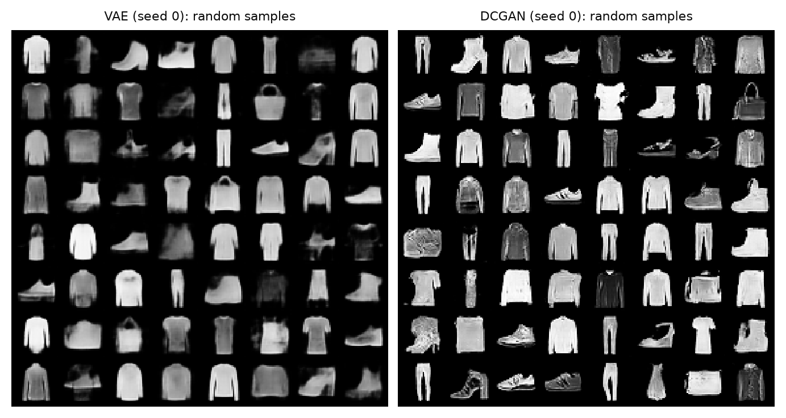
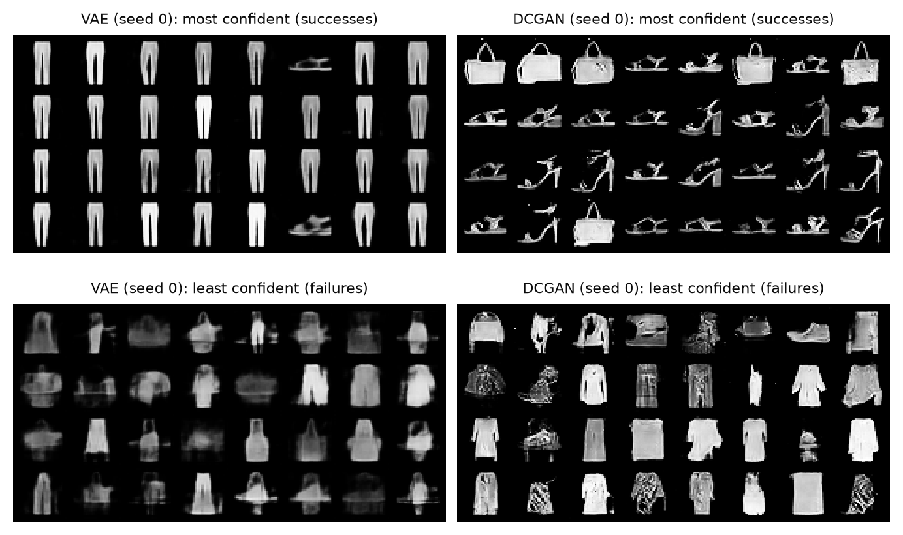

<!-- Build PDF + DOCX:  bash report/build.sh   (needs pandoc and Google Chrome)
     Every number below comes from results/ (generated by src/analysis.py). If the runs
     are redone, regenerate results/ and update the numbers here. -->

## 1. Problem and motivation

A generative image model learns an unknown distribution $p_\text{data}(x)$ from examples and
then produces new images from it. Two classic families do this in very different ways. A
**Variational Autoencoder (VAE)** maximises a lower bound on the likelihood of the data
[1]. A **Generative Adversarial Network (GAN)** trains a generator to fool a learned
discriminator [2]. A common observation is that VAE samples are *blurry but varied*, while
GAN samples are *sharp but may miss parts of the data* ("mode collapse"). This trade-off
between **fidelity** (each sample looks real) and **diversity** (the samples cover the whole
data distribution) matters in practice: synthetic training data is useless if it is
unrealistic and harmful if it covers only some classes. Measuring the trade-off is itself a
vision problem. A generated image has no ground-truth target, so the evaluation must compare
*distributions* of images.

Published comparisons usually give each objective its own separately tuned network, which
makes it hard to tell whether a difference comes from the objective or from the
architecture. We therefore ask: **with the same image-producing network, latent size, data
and training budget, how do a VAE and a DCGAN trade off fidelity/sharpness against
diversity/mode coverage?** We test three hypotheses on Fashion-MNIST (3 seeds, plus two
ablations):

* **H1:** the GAN produces sharper samples with a lower FID.
* **H2:** the VAE covers the data better (higher recall, no mode collapse) and trains more
  stably.
* **H3:** the VAE has a smoother latent space.

## 2. Method

### 2.1 Variational Autoencoder

An encoder maps an image $x$ to the mean $\mu(x)$ and log-variance $\log\sigma^2(x)$ of a
Gaussian posterior $q(z\mid x)$ over a $d$-dimensional latent code. A decoder maps $z$ back to
an image $\hat x$, and the prior is $p(z)=\mathcal N(0,I)$. Training maximises the evidence
lower bound (ELBO) [1]:

$$\log p(x) \;\ge\; \mathbb E_{q(z\mid x)}\big[\log p(x\mid z)\big] \;-\; \mathrm{KL}\big(q(z\mid x)\,\|\,p(z)\big).$$

We use a Gaussian decoder with fixed variance, so $-\log p(x\mid z)$ is the squared error
$\|x-\hat x\|^2$ **summed over pixels** (up to a constant). The KL between two Gaussians has a
closed form, $\tfrac12\sum_j(\mu_j^2+\sigma_j^2-\log\sigma_j^2-1)$. Our loss per image is
therefore

$$\mathcal L_\text{VAE} = \|x-\hat x\|^2 + \beta\,\mathrm{KL}\big(q(z\mid x)\,\|\,\mathcal N(0,I)\big),$$

with $\beta=1$ for the standard VAE and $\beta\neq1$ for a β-VAE [4]. Sampling inside the
network is made differentiable with the *reparameterization trick*,
$z=\mu+\sigma\odot\varepsilon$ with $\varepsilon\sim\mathcal N(0,I)$, so gradients flow
through $\mu$ and $\sigma$.

**Design choice: sum, not mean, over pixels.** A 32×32 image contributes 1024 squared-error
terms, while the KL has only $d=32$ terms. Averaging the reconstruction error over pixels
(a common shortcut) would make the KL about 1000× stronger. That is a hidden β ≈ 1000, which
changes the very blurriness we want to measure. With the sum, the loss is the true negative
ELBO and β is the only weight on the KL.

**Why VAEs blur.** For a given $z$, the decoder output that minimises expected squared error
is the *mean* of all images whose posteriors overlap at $z$. The KL term pulls every
posterior towards the same prior, so these posteriors do overlap. The decoder then outputs an
average of several plausible images, for example shirts with different textures, and
averaging acts as a low-pass filter.

### 2.2 Deep Convolutional GAN

A generator $G$ maps $z\sim\mathcal N(0,I)$ to an image, and a discriminator $D$ outputs the
probability that its input is real. $D$ minimises binary cross-entropy (real → 1,
fake → 0). $G$ minimises the *non-saturating* loss $-\log D(G(z))$. This has the same fixed
point as the original minimax game but gives stronger gradients early in training, when $D$
easily rejects the fakes [2]. We follow the DCGAN recipe [3]: strided (transposed)
convolutions, batch normalisation, ReLU/LeakyReLU, $\mathcal N(0,0.02)$ initialisation, and
Adam with learning rate $2\cdot10^{-4}$ and $\beta_1=0.5$. We alternate one $D$ step and one
$G$ step.

**Why GANs are sharp but can drop modes.** $D$ is itself a CNN and detects blur easily, so $G$
is pushed towards crisp, realistic images. However, $G$ is only penalised for samples that
*look fake*, never for data it *fails to produce*. Nothing in the objective asks $G$ to cover
every mode, so mapping many latent codes to a few convincing images is a stable shortcut
(the "Helvetica scenario" in [2]).

### 2.3 One architecture for both models (fairness by construction)

The VAE decoder and the GAN generator are the **same class**, `ConvDecoder`. Its transposed
convolutions grow the image from 1×1 to 4, 8, 16 and 32 pixels with 256/128/64 channels,
BN + ReLU and a tanh output (788k parameters). The VAE encoder and the discriminator are also
one class, `ConvEncoder`. Its strided convolutions shrink the image from 32 to 4 pixels with
LeakyReLU, and only its output head differs: $2d$ numbers ($\mu$, $\log\sigma^2$) for the VAE
and one logit for $D$. Unit tests check that the image networks are identical and that
neither model config overrides a shared setting (Table 1).

| Shared by both models | Different (and why) |
|---|---|
| Data, padding, scaling to [−1, 1] | **Training objective**: the variable under study |
| Image-producing network (`ConvDecoder`, 788k params) | Encoder head: 2d outputs (VAE) vs. 1 (D) |
| Latent size $d=32$, batch size 128, 30 epochs, seeds 0/1/2 | Optimiser settings: each paper's standard (VAE: Adam $10^{-3}$; DCGAN: Adam $2\cdot10^{-4}$, $\beta_1=0.5$) |
| DCGAN weight initialisation | |
| Evaluation code, the 10,000 latent vectors, all metrics | |

: **Table 1.** Fair-comparison protocol. Shared settings live in one config file
(`configs/shared.yaml`) that both model configs inherit.

### 2.4 Evaluation

We compare the *distribution* of 10,000 generated images with the 10,000 Fashion-MNIST test
images (Table 2) in two feature spaces. The first is the standard **Inception-v3** pool
features for FID [5] (2048-d). The second is the 128-d penultimate layer of our own
**evaluation CNN** (90.7% test accuracy), which is trained only to *measure* the generators.
We add it because Inception was trained on ImageNet photographs, not on 32×32 grayscale
clothing.

| Metric | What it measures | Better |
|-----------------|----------------------------------------------------------------------|------|
| FID [5] | Fréchet distance between Gaussians fitted to real and generated features: fidelity + diversity | ↓ |
| Precision / recall [6] | share of generated samples inside the real manifold (fidelity) / of real samples inside the generated manifold (diversity); $k=3$ nearest-neighbour balls | ↑ |
| Modes, class KL | evaluation-CNN labels of the samples: classes with ≥1% of them; KL($p_\text{gen}\,\|\,p_\text{real}$) | ↑ / ↓ |
| Laplacian var. [7] | edge strength (2nd-derivative filter) | ≈ real |
| HF ratio | share of 2-D FFT energy above 0.25 cycles/pixel | ≈ real |
| Interp. CV | std/mean of feature-space steps along 100 slerp paths [8] of 10 frames; proxy for perceptual path length [9] | ↓ |
| NN ratio | median pixel distance generated → nearest training image, divided by the same for test images | ≈ 1 |
| Recon. PSNR | VAE only: encoder–decoder reproduction of test images | ↑ |

: **Table 2.** Metrics. The two sharpness metrics are classical CV operations (edge detection
and the Fourier transform). Values *above* the real level mean noise, not extra sharpness.

Two checks make these numbers interpretable. First, **unit tests on inputs with a known
answer**: identical sets give FD = 0; a "generator" that produces only one of two clusters
gets precision > 0.95 but recall ≈ 0.5; blurring lowers both sharpness measures. Second, a
**real-vs-real baseline** runs the same metric code with 10,000 real *training* images in
place of the generated ones. This gives the best score a perfect generator could expect with
our sample size and feature spaces.

## 3. Implementation and data

**Data.** Fashion-MNIST [10] has 60,000 training and 10,000 test grayscale 28×28 images in
10 balanced clothing classes. We **zero-pad** the images to 32×32 instead of resizing them,
because interpolation would blur the *real* images, which are the reference for our
sharpness metrics. Pixels are scaled to [−1, 1] to match the tanh output. The models train on
the training split only, and the test split is the reference for every metric.

**Code.** We wrote the project in PyTorch (commands in `README.md`). Every run saves its
config, a per-epoch loss log, sample grids and a checkpoint every 5 epochs. One script
evaluates both models with the same 10,000 latent vectors, so the grids in this report show
the same random draws for both models and are not cherry-picked. Every table and figure is
generated by `src/analysis.py` from the saved metrics. For Inception we use the standard FID
port in torchmetrics/torch-fidelity [11]. There are 49 automated tests, including one that
runs the whole pipeline end to end on a toy dataset.

**Training.** Each model trains for 30 epochs: 468 mini-batches of 128 images per epoch,
14,040 updates in total. We use seeds 0, 1 and 2 on a laptop GPU (Apple silicon, PyTorch MPS).
A VAE run takes about 4 minutes and a DCGAN run about 6.5, because the GAN needs two
forward/backward passes per step.

## 4. Experiments and results

We run four experiments:

* **E1, main comparison.** VAE vs. DCGAN at the default settings, 3 seeds each.
* **E2, learning curves.** Every saved checkpoint (every 5 epochs) of the E1 runs, evaluated
  with 5,000 samples.
* **E3, latent size.** $d\in\{8,32,128\}$ for both models.
* **E4, KL weight.** $\beta\in\{0.5,1,4\}$ for the VAE.

E3 and E4 use one seed (seed 0); their $d=32$, $\beta=1$ entries are the E1 means.

### 4.1 Main comparison (E1)

| Model | FID-Inc ↓ | FID-clf ↓ | Prec. ↑ | Recall ↑ | Class KL ↓ | Lapl. var | HF ratio | Interp. CV ↓ |
|---|---|---|---|---|---|---|---|---|
| VAE | 56.9 ± 1.6 | 20.7 ± 1.2 | 0.695 ± 0.008 | 0.489 ± 0.007 | 0.22 ± 0.01 | 0.038 ± 0.001 | 0.034 ± 0.001 | **0.51 ± 0.01** |
| DCGAN | **13.3 ± 0.5** | **1.29 ± 0.05** | **0.852 ± 0.008** | **0.854 ± 0.001** | **0.022 ± 0.005** | **0.146 ± 0.001** | **0.100 ± 0.004** | 0.69 ± 0.02 |
| Real data | 2.40 | 0.034 | 0.903 | 0.893 | 0.005 | 0.150 | 0.104 | – |

: **Table 3.** Main results, mean ± std over 3 seeds (precision/recall in the classifier
space). Last row: the same metrics on 10,000 real training images. Bold = better model.
Every run covers all 10 classes.

{width=50%}

{width=45%}

The DCGAN scores better than the VAE on every metric except interpolation CV (Table 3). Its
FID is 16× lower in the classifier space (1.29 vs. 20.7) and 4× lower in the Inception space
(13.3 vs. 56.9). Its precision and recall (0.85 / 0.85) are close to the real-data baseline
(0.90 / 0.89), while the VAE reaches 0.70 precision but only 0.49 recall (Figure 2). Both
models produce all 10 classes, but the VAE's class distribution is 10× further from the real
one (KL 0.22 vs. 0.022). The DCGAN's Laplacian variance and HF ratio are within 4% of the real
images; the VAE keeps about a quarter of the real edge energy and a third of the
high-frequency energy, visible as blur in Figure 1.

### 4.2 Training dynamics (E2)

The DCGAN's FID-clf falls fast until epoch 15 (11.3 → 2.6) and then slowly (1.5 at epoch 30).
The VAE improves more slowly and is **still improving at epoch 30** (22.3 → 21.1 over the
last 5 epochs; Figure 3). To test whether this budget is fair, we trained VAE seed 0 for 60
epochs: FID-clf fell only from 21.1 to 18.4 (recall 0.49 → 0.52, Laplacian variance
0.039 → 0.044), closing 14% of the gap to the DCGAN, so we kept 30 epochs. The min–max
bands are narrow for both models, and the discriminator never overpowered the generator: in
every epoch of all seeds $D(G(z))$ stayed in [0.17, 0.32] and $D(x)$ in [0.68, 0.83].

{width=46%}

### 4.3 Ablations (E3, E4)

| FID-clf / recall | $d=8$ | $d=32$ | $d=128$ |
|---|---|---|---|
| VAE | 19.7 / 0.40 | 20.7 / 0.49 | 22.5 / 0.49 |
| DCGAN | 1.19 / 0.82 | 1.29 / 0.85 | 2.04 / 0.85 |

: **Table 4.** Latent-size ablation.

**Latent size (Table 4).** The ranking never changes. The only clear effect is that $d=8$
lowers the VAE's recall (0.40 vs. 0.49) and PSNR (21.3 vs. 22.4 dB); other differences are
within the seed noise of E1.

| β | FID-clf ↓ | Prec. ↑ | Recall ↑ | Lapl. var | Interp. CV ↓ | Recon PSNR ↑ |
|---|---|---|---|---|---|---|
| 0.5 | 22.0 | 0.64 | **0.61** | **0.041** | **0.45** | **23.4** |
| 1 | **20.7** | 0.70 | 0.49 | 0.038 | 0.51 | 22.4 |
| 4 | 24.0 | **0.72** | 0.14 | 0.028 | 0.63 | 20.1 |

: **Table 5.** KL-weight ablation for the VAE (real Laplacian variance: 0.150).

**KL weight (Table 5).** As expected, a larger β makes the samples blurrier (Laplacian
variance 0.041 → 0.028) and the reconstructions worse. It also moves the VAE along the
precision–recall trade-off: precision rises slightly (0.64 → 0.72) while recall collapses
(0.61 → 0.14). Contrary to our expectation, the latent space did **not** become smoother: the
interpolation CV rose from 0.45 to 0.63.

## 5. Analysis and discussion

**H1: fidelity and sharpness. Supported.** The DCGAN's edge statistics match the real images
(Laplacian variance 0.146 vs. 0.150, HF ratio 0.100 vs. 0.104) without exceeding them, so its
sharpness is real detail rather than noise. Precision and FID agree in both feature spaces.
This is what §2 predicts: the squared-error loss makes the VAE decoder output a conditional
*mean*, which erases any detail that differs between the plausible images behind a code,
whereas a CNN discriminator easily detects missing high frequencies and pushes the generator
to produce them. E4 confirms the mechanism: a stronger KL means more averaging and less
sharpness.

**H2: diversity, mode coverage and stability. Not supported**, which is our most interesting
result. The DCGAN does not drop modes: every class makes up 6–13% of its samples (ideal 10%),
and its recall is close to the real baseline. The VAE produces all 10 classes but unevenly:
too many pullovers (25%) and ankle boots (18%), too few coats (2%) and sandals (5%). These
pairs differ mainly in *fine detail* (a coat is a pullover with a zip; a sandal is an ankle
boot with gaps between the straps), so once blur removes the detail, the evaluation CNN labels
the sample as the plainer class. Blur also explains the low recall. Recall asks whether each
real image lies within the k-NN ball of some generated sample, and real images defined by
texture or thin structures have no blurry counterpart nearby. In a learned feature space,
blur therefore costs **diversity as well as fidelity**. Nor was the GAN less stable: the
relative seed-to-seed std of FID is 3–6% for both models, and $D$ never overpowered $G$
(§4.2). Mode collapse simply did not occur on this balanced dataset with the DCGAN recipe.

**H3: latent smoothness. Supported, with a caveat.** The VAE's interpolation steps are more
even (CV 0.51 vs. 0.69). In `qualitative_interpolation.png` the VAE paths morph gradually
(trousers widen into a dress), while several DCGAN paths stay almost constant and then jump in
the last frames (a sneaker turns into trousers). The KL term makes the posteriors of similar
images overlap, so nearby codes decode to similar images; the GAN loss never constrains what
lies *between* two codes. The caveat is E4: a larger β raised the CV, perhaps because a
strong KL switches off most latent dimensions, so the output barely changes inside a class and
then jumps at a class boundary (one seed, so this remains a hypothesis).

**Successes and failures.**

{width=46%}

The two models succeed on different classes (Figure 4, top): the VAE on trousers, whose
silhouette survives blur, and the DCGAN on bags and high-heeled sandals, exactly the
fine-structured classes the VAE under-produces. The VAE's failures are blurry *blends of two
classes* (half shirt, half bag): the averaging of §2.1 made visible. The DCGAN's failures are
sharp but wrong: high-frequency texture artefacts and shapes halfway between shirt, dress and
coat, with no repeated items. Neither model copies its training data (NN ratio 1.00 for the
VAE, 1.07 for the DCGAN). The β = 4 VAE's 0.80 looks like memorisation, but a
blurry average image is simply close in pixel distance to many training images.

**Limitations.**

* FID-Inception runs on 32×32 grayscale images, far from ImageNet; even real-vs-real
  precision/recall there is only 0.78 (0.90 with our classifier). Both spaces rank the models
  the same way, so we **lead with the classifier space** and report FID-Inception for
  comparability.
* The evaluation classifier (90.7% accuracy) is less confident on blurry samples (mean
  confidence 0.79 VAE, 0.88 DCGAN, 0.93 real), so class coverage partly measures blur.
* The VAE was still improving slowly at epoch 30 (§4.2); the ablations use one seed; the GAN
  has no encoder, so reconstruction is measured for the VAE only.
* One small architecture and dataset, and untuned paper-default optimisers: the results may
  not transfer to larger models or colour images.

## 6. Conclusion

With the same network, data and budget, the DCGAN beats the VAE on Fashion-MNIST in fidelity
**and** diversity (FID-clf 1.3 vs. 20.7, recall 0.85 vs. 0.49); the VAE keeps a smoother
latent space and an encoder. H1 and H3 held, but H2 did not: the GAN never collapsed, and the
VAE's blur cost it coverage as well as sharpness, because in a learned feature space blur and
diversity are not independent. β moves the VAE along the precision–recall trade-off but, for
the values we tried, never towards the DCGAN. A natural next step is to remove the blur at its
source (a learned decoder variance or a perceptual loss) and test whether the VAE's recall
recovers.

## References

[1] D. P. Kingma, M. Welling. *Auto-Encoding Variational Bayes.* ICLR, 2014.

[2] I. Goodfellow et al. *Generative Adversarial Nets.* NeurIPS, 2014.

[3] A. Radford, L. Metz, S. Chintala. *Unsupervised Representation Learning with Deep Convolutional Generative Adversarial Networks.* ICLR, 2016.

[4] I. Higgins et al. *β-VAE: Learning Basic Visual Concepts with a Constrained Variational Framework.* ICLR, 2017.

[5] M. Heusel et al. *GANs Trained by a Two Time-Scale Update Rule Converge to a Local Nash Equilibrium.* NeurIPS, 2017.

[6] T. Kynkäänniemi et al. *Improved Precision and Recall Metric for Assessing Generative Models.* NeurIPS, 2019.

[7] J. L. Pech-Pacheco et al. *Diatom Autofocusing in Brightfield Microscopy: A Comparative Study.* ICPR, 2000.

[8] T. White. *Sampling Generative Networks.* arXiv:1609.04468, 2016.

[9] T. Karras, S. Laine, T. Aila. *A Style-Based Generator Architecture for Generative Adversarial Networks.* CVPR, 2019.

[10] H. Xiao, K. Rasul, R. Vollgraf. *Fashion-MNIST: a Novel Image Dataset for Benchmarking Machine Learning Algorithms.* arXiv:1708.07747, 2017.

[11] N. Detlefsen et al. *TorchMetrics: Measuring Reproducibility in PyTorch.* JOSS, 2022; A. Obukhov et al. *torch-fidelity*, 2020.
